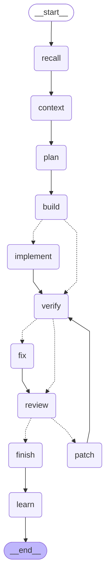

# AutoCode — Autonomous Local Coding Agent

AutoCode is a multi-agent, self-verifying code generator. It runs against **local models** (Ollama, LM Studio, vLLM) or **hosted ones** (OpenAI, Anthropic, Gemini, Groq, OpenRouter, DeepSeek, Mistral, Together, or any OpenAI-compatible endpoint), and you can mix them per step. Give it a plain-language requirement, or point it at an existing project. It plans, writes, critiques, patches, fixes, and runs the code in a closed loop until it passes or hits a retry limit. It **remembers and learns** from every run.

It ships as an **installable desktop app** (a native window, not a website), a CLI, an **MCP server** that Claude Code or Cursor can call, and an **A2A agent** that other agents can delegate to.

## The ten quality dimensions

Every run plans, builds, and checks the code along ten dimensions, in this order:

| # | Dimension | What it covers |
|---|---|---|
| 1 | Business Logic | The core functionality and rules that solve the user's problem |
| 2 | Security | Authentication, authorization, encryption, input validation, and protection against vulnerabilities |
| 3 | UI/UX | How users interact with the application and how intuitive and pleasant it is to use |
| 4 | Performance | Fast response times, efficient resource usage, and scalability under load |
| 5 | Reliability & Availability | The system works consistently, handles failures gracefully, and has high uptime |
| 6 | Maintainability | Clean, modular, well-documented code that is easy to update and debug |
| 7 | Scalability | Handling more users, data, and traffic without major redesign |
| 8 | Data Management | Efficient database design, data integrity, backups, and consistency |
| 9 | Testing & Quality Assurance | Unit, integration, and end-to-end tests, code reviews, and CI/CD |
| 10 | Observability & Monitoring | Logging, metrics, tracing, and alerting to detect and diagnose production issues |

## Pipeline

```
requirement
  → context      MCP tools (optional)
  → base plan    files, architecture, test command
  → 10-step plan one step per dimension, each seeing the decisions of the steps before it
  → build        step 1 builds the Business Logic foundation; steps 2–10 each make their own code changes
  → review loop  validate → 10 dimension reviewers (+ A2A peers) score against their own plan → patch
                 repeat until every reviewer passes and validation succeeds, or max_iterations is reached
```

1. **Context Agent**: if MCP servers are configured, it picks up to three tool calls (docs, issues, schemas) and passes the results on.
2. **Planner**: turns the requirement into a base plan. With an existing project, it plans a change instead of a rewrite.
3. **Dimension Planner (10 steps)**: each dimension writes its own plan: requirements, design decisions, files to touch, and acceptance checks that a reviewer can confirm in the code. A dimension that does not fit the project (for example, Data Management for a CLI with no storage) says so and gives a reason. If a planning call fails, the step falls back to the dimension's checklist so the run continues.
4. **Generator, then Dimension Implementers**: the generator builds the Business Logic foundation. Then each applicable dimension, from Security to Observability, changes the code for its own plan on top of the earlier steps. Not-applicable dimensions are skipped. **Fast mode** (`--fast`, `FAST_MODE=true`) does a single generation pass instead.
5. **Validator**: runs the plan's test command (or a compile check) before each review round, so reviewers see test failures.
6. **Dimension Reviewers**: the same ten dimensions score the code in parallel against their own acceptance checks and weighted criteria, and propose unified-diff patches. **A2A peers** join as extra reviewers.
7. **Patch Engine**: applies the patches with `git apply`. Patches that fail feed back into memory.
8. **Result**: if every gate passes, the run returns that version. Otherwise it returns the best reviewed version (passing first, then verified, then the highest average score), not just the last one.

The Plan tab in the app shows all ten steps live: what each dimension planned, what it changed, and how it scored.

### The pipeline graph (LangGraph)

The control flow is a [LangGraph](https://github.com/langchain-ai/langgraph) `StateGraph` (`agent_platform/graph.py`). It covers the fast-mode skip, the fix branch when tests fail, and the review and patch loop that stops on a pass or at the round limit. Each node is one step method on the orchestrator. Every transition is streamed to the app, so the pipeline stepper above the reviewer scores shows the current node and round. The diagram below is generated from the compiled graph with `python -c "from agent_platform.graph import pipeline_diagram; print(pipeline_diagram())"`.



LangChain itself is not used. The provider layer already covers local and hosted models with JSON mode, retries, per-call metrics, and cancellation, so adding LangChain's model wrappers would mean more dependencies for no new capability.

## Desktop app

Download or build `AutoCode.dmg` (macOS) or the `AutoCode` folder (Windows/Linux) and open it. The app runs its backend on a private loopback port and shows the UI in a native window (WKWebView, WebView2, or WebKitGTK).

- Choose a project folder, describe the change, and press **Ctrl/Cmd+Enter**.
- Watch the reviewer gauge fill in live, read per-file diffs, then **Write files** to disk.
- If Ollama, the model, or Git is missing, a banner says exactly what to install.

Build it yourself:

```bash
./scripts/build_desktop.sh          # macOS: dist/AutoCode.app + dist/AutoCode.dmg; Linux/Windows: dist/AutoCode/
```

Requirements on the user's machine: [Ollama](https://ollama.com) with the model pulled (`ollama pull qwen3:4b`) and Git.

Everything AutoCode keeps lives in `~/.autocode/` (or `$AUTOCODE_HOME`):

| Path | Contents |
|---|---|
| `.env` | Settings (same keys as `.env.example`) |
| `mcp.json` | MCP servers for the context agent |
| `runs/<id>.json` | Run history (the last 50 runs; only changed files are stored; written atomically) |
| `logs/autocode.log` | Rotating log of run lifecycle, per-call model latency and tokens, failures, and HTTP requests |
| `desktop.log` | Crash traceback from the desktop window |

A full run makes about 1 + 10 + 10 model calls before reviewing, plus 10 per review round. The app header shows calls and tokens as the run progresses. Use fast mode on slow hardware.

## Running from source

```bash
python -m venv .venv && source .venv/bin/activate
pip install -r requirements.txt -r requirements-desktop.txt
npm --prefix ui ci && npm --prefix ui run build

python app.py desktop                              # native window
python app.py serve                                # same UI at http://127.0.0.1:8000 (+ A2A endpoint)
python app.py "Build a FastAPI signup endpoint"    # CLI, prints the files
python app.py "Add input validation" --workspace ~/code/api            # edit a project in place
python app.py "Add input validation" --workspace ~/code/api --dry-run  # print diffs only
```

UI development with hot reload: run `python app.py serve`, then `npm --prefix ui run dev` (Vite proxies `/api` to port 8000).

## MCP

**AutoCode as an MCP server.** Claude Code, Cursor, or any MCP client can call it:

```bash
claude mcp add autocode -- python /path/to/AutoCode/app.py mcp
```

Tools: `generate_code` (with an optional `workspace` and `write`), `review_code` (files or a workspace), and `list_reviewers`. Long runs send `notifications/progress` and honour cancellation.

**AutoCode as an MCP client.** Put servers in `~/.autocode/mcp.json` (or set `MCP_CONFIG`), in the same format Claude Code and Cursor use:

```json
{ "mcpServers": { "docs": { "command": "npx", "args": ["-y", "@some/mcp-server"], "env": {} } } }
```

Only stdio servers are supported.

## Agent-to-agent (A2A v1.0)

`python app.py serve` (and the Docker image) publishes an agent card at `/.well-known/agent-card.json` and a JSON-RPC endpoint at `/a2a` with `SendMessage`, `GetTask`, and `CancelTask`. It offers two skills:

- `generate`: send the requirement as a text part, plus an optional data part `{"workspace": "...", "settings": {...}}`. You get one artifact per changed file and a review artifact.
- `review`: send a data part `{"skill": "review", "files": {"path": "content"}}`. You get the ten persona reviews.

Set `A2A_PEERS=http://127.0.0.1:8001,...` (or use the UI settings) to add other A2A agents as reviewers. For example, run a second AutoCode with a different model on port 8001. Review-only tasks never call peers, so two instances cannot loop.

## Configuration

Every option can be set with an environment variable (see `.env.example`), a CLI flag, or the UI settings panel:

| Flag | Purpose |
|---|---|
| `--model` | Ollama model to use |
| `--ollama-host` | Ollama server address |
| `--max-iterations` | Max review → patch → validate cycles |
| `--passing-score` | Minimum per-persona score to accept the code |
| `--max-retrieved-files` | Files each persona sees |
| `--skip-verify` | Skip running the validation command |
| `--command-timeout-seconds` | Timeout for validation commands and MCP calls |
| `--mcp-config` | MCP servers file for the context agent |
| `--a2a-peers` | Comma-separated A2A agent URLs used as extra reviewers |
| `--fast` | One generation pass instead of ten per-dimension implementation passes |

## Security notes

- The Validator runs the **model-written test command** with `shell=True` in a temp directory on your machine. Use Docker if you need isolation.
- The HTTP server binds to `127.0.0.1` by default. It rejects cross-origin writes and foreign `Host` headers (DNS rebinding). It has no authentication, so do not expose it to a network.
- Patch and write paths are confined to the project folder (no absolute paths or `..`).

## Memory and learning

AutoCode improves with use without retraining any model:

- **Memory (Postgres + pgvector).** After every run, a critic agent looks at what each step planned, changed, and scored. It writes concrete lessons about what that step should do better next time. Lessons are embedded with a neural embedding model (`nomic-embed-text` by default) and stored in Postgres with pgvector. Before the next similar task, the most relevant lessons are recalled into the planning, implementation, and fix prompts. Duplicate lessons are skipped.
- **Reinforcement learning.** Each dimension's implementation step picks a strategy (focused, thorough, or test-first) by Thompson sampling over a Beta posterior per dimension and strategy. The reward is that dimension's final review score, so the strategies that work for each dimension get chosen more often.
- **Fixer agent.** When the test command fails, a debugging agent reads the failure, repairs the code, and verifies again before the reviewers see it.

The **Memory** tab shows what AutoCode has learned and the score of each strategy for each dimension. You can search lessons, forget single lessons, or clear everything. Turn learning off in Settings.

What this is not: the language model's weights are never fine-tuned. Learning lives in the memory and in the strategy policy around the model, so it works the same with any local or hosted model. If no Postgres is configured, memory uses a local SQLite file. If the embedding model is unavailable, it falls back to keyword hashing.

## Models

Every model is a `<provider>:<model>` spec, such as `ollama:qwen3:4b`, `openai:gpt-5-mini`, `anthropic:claude-opus-5-5`, or `gemini:gemini-2.5-flash`. Set the default model, plus an optional model per role (planning, coding, reviewing, reflection), in **Settings**. A common mix is a strong hosted planner with fast local reviewers. Add any OpenAI-compatible server as a custom provider.

API keys are read from the environment (`OPENAI_API_KEY`, `ANTHROPIC_API_KEY`, `GEMINI_API_KEY`, ...) or pasted in Settings. Pasted keys are saved to `~/.autocode/settings.json` with `0600` permissions and are never sent back to the UI in full. Single runs, and remote A2A agents, cannot change providers, base URLs, or the memory database, so a request cannot redirect your keys.

Anthropic models go through the official SDK with server-side refusal fallback enabled (`fallbacks: "default"`), so a safety-declined request is retried on a fallback model within the same call.

## Docker (zero configuration)

```bash
./scripts/start.sh         # or: docker compose up -d --build
```

This one command starts everything, with no `.env` needed:

- **Ollama**, which downloads the chat model (`qwen3:4b`) and the embedding model (`nomic-embed-text`)
- **Postgres 17 with pgvector** for memory
- **AutoCode** at http://127.0.0.1:8000

Settings, history, and logs persist in Docker volumes. Hosted-model keys set in your shell are passed through. While this stack is running, the desktop app finds the Postgres memory on its own. The first start downloads several GB of models.

## Tests

```bash
pip install -r requirements-dev.txt
python -m pytest           # backend, MCP, A2A, HTTP API (uses a scripted fake LLM; no Ollama needed)
npm --prefix ui test       # UI state reducer
```

GitHub Actions (`.github/workflows/ci.yml`) runs ruff and pytest on Python 3.11 and 3.13 against a pgvector Postgres service, then the UI typecheck, tests, and build. Locally, the pgvector test runs when `TEST_DATABASE_URL` points at a Postgres with pgvector (for example the compose one).

## Project structure

```
AutoCode/
├── app.py                    # Entry point
├── agent_platform/
│   ├── cli.py                # CLI + subcommands: desktop, serve, mcp
│   ├── orchestrator.py       # Step methods: plan, build, implement, verify, fix, review, patch
│   ├── graph.py              # LangGraph state machine wiring the steps together
│   ├── personas.py           # the ten dimensions (definitions, checklists, weights)
│   ├── dimensions.py         # per-dimension planner and implementer
│   ├── planner.py / generator.py / reviewer.py / retriever.py
│   ├── context_agent.py      # MCP tool selection before planning
│   ├── patch_engine.py / validator.py / memory.py / workspace.py
│   ├── providers.py          # Ollama, OpenAI-compatible and Anthropic providers
│   ├── llm.py                # Per-role model clients (JSON mode, retry, cancellation, metrics)
│   ├── settings.py           # Settings saved from the app (masked keys, locked fields)
│   ├── memory_store.py       # pgvector / SQLite memory and strategy statistics
│   ├── learning.py           # Recall, reflection critic, Thompson-sampling strategy policy
│   ├── fixer.py              # Repairs failing tests before review
│   ├── services.py           # Health checks, model downloads, memory/learning views
│   ├── runs.py               # Background runs, event log, metrics, saved history
│   ├── logs.py               # Rotating file log
│   ├── server.py             # HTTP API, SSE events, static UI, A2A routes
│   ├── a2a.py / a2a_client.py
│   ├── mcp_server.py / mcp_client.py
│   └── desktop.py            # Native window (pywebview)
├── ui/                       # React + TypeScript (Vite) desktop UI
├── packaging/autocode.spec   # PyInstaller spec
├── scripts/build_desktop.sh
└── tests/
```
